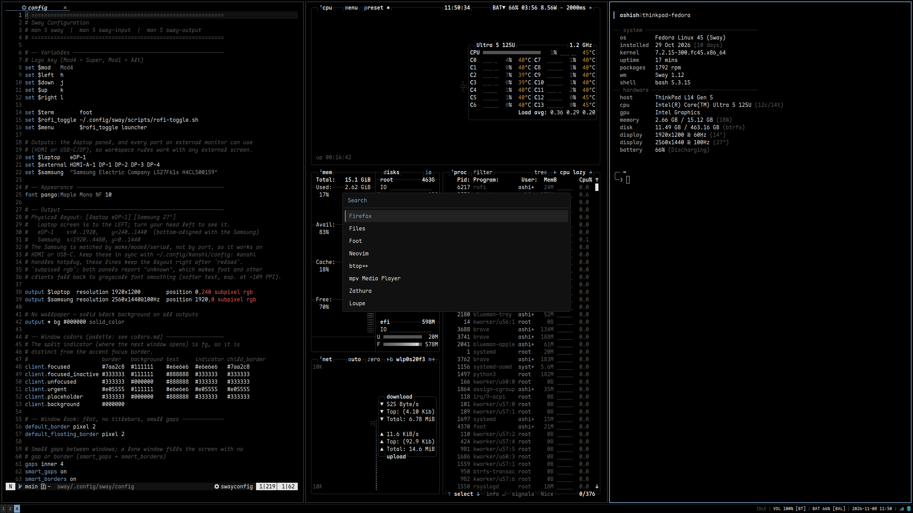

# Sway Dotfiles

Keyboard-driven Wayland desktop on **Sway**, managed with **GNU Stow**. Built for a laptop plus a 27" 1440p 100 Hz external display, with automatic display profiles (Kanshi) and clamshell handling.



Monochrome greys with one blue-grey accent (`#7aa2c8`) for focus only. Palette in [`colors.md`](colors.md).

## Install (fresh Fedora)

```bash
git clone git@github.com:ashishreddy-15/swaywm.git ~/swaywm
cd ~/swaywm
./install.sh --dry-run          # preview
./install.sh                    # install packages, font, dotfiles, defaults
./install.sh --with-snapshots   # optional: btrfs snapshots (sudo)
./install.sh --with-sddm        # optional: themed login screen (sudo)
```

`install.sh` is safe to re-run. Existing files that block a symlink are moved to `~/.dotfiles-backup-<date>/`, never deleted.

## Packages

Each directory is a Stow package, linked into `~` (`.stowrc` sets the options).

| Package | Purpose |
| :--- | :--- |
| `sway` | Window manager config, keybindings, scripts |
| `kanshi` | Monitor profiles: `dual`, `external`, `solo` |
| `waybar` | Status bar |
| `rofi` | Launcher, power menu, clipboard menu |
| `dunst` | Notifications |
| `foot` | Terminal |
| `swaylock` | Screen locker |
| `bash`, `starship` | Shell and prompt |
| `nvim`, `btop`, `fastfetch`, `mpv`, `zathura` | Editor, monitor, system info, video, PDF |
| `fontconfig`, `xdg-desktop-portal-wlr` | Fonts, screen sharing |

```bash
stow -v sway       # link a package
stow -R -v sway    # relink after adding/removing files
stow -D -v sway    # unlink
```

`setup/` holds system-level scripts and is not a package.

## Displays

* Laptop `eDP-1` (workspaces 6-10) and external (workspaces 1-5), bottom-aligned.
* Kanshi picks the profile; the Samsung is matched by model, so any port works.
* Closing the lid with an external screen attached turns the laptop panel off ([`lid-handler.sh`](sway/.config/sway/scripts/lid-handler.sh)).

## Keybindings

`$mod` = Super.

| Shortcut | Action |
| :--- | :--- |
| `$mod + Return` | Terminal |
| `$mod + d` | Launcher |
| `$mod + x` | Power menu |
| `$mod + v` | Clipboard history |
| `$mod + q` | Close window |
| `$mod + h/j/k/l` | Focus left/down/up/right |
| `$mod + 1..0` | Workspace 1-10 (`Shift` moves the window) |
| `$mod + Tab` | Focus other monitor (`Shift` sends workspace) |
| `$mod + f` | Fullscreen |
| `$mod + Shift + Space` | Toggle floating |
| `$mod + b` / `Shift + v` | Split horizontal / vertical |
| `$mod + s` / `w` / `e` | Stacking / tabbed / toggle split |
| `$mod + r` | Resize mode |
| `$mod + [` / `]` | Dim / brighten focused screen |
| `$mod + n` | Night light |
| `$mod + Shift + Return` | Drop-down terminal |
| `$mod + c` | Calculator |
| `$mod + .` | Emoji picker |
| `$mod + Shift + a` | Appearance: GTK theme, dark/light, icons, cursor, font |
| `$mod + grave` | Last notification (`Shift`: dismiss all) |
| `$mod + Shift + n` | Do not disturb |
| `$mod + Shift + r` | Reload config |
| `$mod + Shift + Escape` | Lock |
| `Print` / `Alt + Print` / `Ctrl + Print` | Screenshot: screen / window / area |
| `Shift + Print` | Record an area |

## Optional setup

* **Snapshots** (btrfs + snapper, optional USB backup): [`docs/snapshots.md`](docs/snapshots.md)
* **Login screen** (SDDM `mono` theme): `./setup/sddm.sh`, remove with `./setup/sddm.sh --uninstall`. If the greeter fails, press Ctrl+Alt+F3, log in, then `sudo rm /etc/sddm.conf.d/10-swaywm.conf && sudo systemctl restart sddm`.
